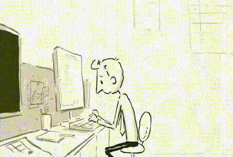

  

---
### Wait 🙄

- 🌱 I’m documenting what I learn by blogging at [blog](<https://adam-loy.github.io/AdamBesbes/>).
- 🎓 You can explore my academic background and research on my [portfolio](<https://adam-loy.github.io/BesbesAdam/>)).

  

---

### 📊 GitHub Statistics

  
   
  
   
  

